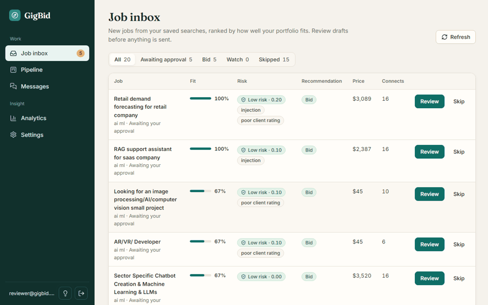
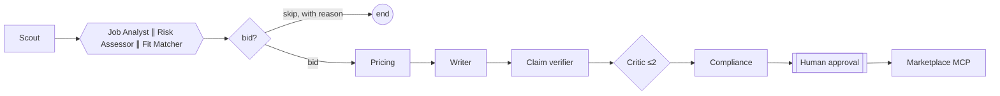

# GigBid — a multi-agent freelancer copilot



GigBid finds freelance jobs, flags scams and planted prompt injections, decides whether a job is worth the
Connects, and drafts proposals in which **every claim links to real portfolio evidence**. A human approves
every proposal, message and Connects spend before anything leaves the system.

- **Live app:** _LIVE_URL_ (reviewer login shared privately)
- **Demo video (3 min):** _VIDEO_URL_
- **Traces:** skipped scam _TRACE_SCAM_ · approved proposal _TRACE_APPROVED_ · critic loop _TRACE_CRITIC_
- **Portfolio MCP server:** [`mcp_servers/portfolio`](mcp_servers/portfolio/README.md) (`uvx --from git+<repo> gigbid-portfolio-mcp`)
- **Write-up:** _WRITEUP_URL_

## How it works



- **Two LangGraph graphs** (bid per job, conversation per client thread), hand-written `StateGraph`, parallel
  analysis via `Send`, bounded critic loop, `interrupt()` approvals, Postgres checkpointer (survives crashes, submits
  exactly once), style and outcome memory with explicit promotion rules. See [docs/ARCHITECTURE.md](docs/ARCHITECTURE.md).
- **MCP everywhere:** our Portfolio, Marketplace and Workspace servers (schemas, annotations, idempotency keys,
  `dry_run`, bearer auth, rate limit, append-only audit log) + the official Upwork MCP server behind the same
  marketplace port ([docs/TOOLS.md](docs/TOOLS.md)).
- **Measured RAG:** 6 retrieval variants, ablation, claim splitting and verification ([docs/DATA_CARD.md](docs/DATA_CARD.md)).
- **Open models only:** gpt-oss-20b for cheap nodes, gpt-oss-120b for writer/critic/liaison on Groq; a deterministic
  `offline` profile runs the whole system without any key (CI).
- **Data:** 112,660 real Upwork postings from Kaggle (pricing statistics, real job stream) + clearly-labelled synthetic
  personas, clients, proposals and dev labels. GigSim, our marketplace simulator, scores proposals with hidden client
  preferences.

## Results

All numbers come from files in [`evals/results/`](evals/results) and are regenerated by `scripts/run_evals.sh`
(`python -m scripts.make_results_table` rewrites this section; CI checks every number traces to a results file).

<!-- results:start -->
<!-- results:end -->

**What ships:** V2 (requirement decomposition + BM25/dense fusion, no reranker). The cross-encoder looked like the
obvious upgrade, but on short skill queries the MS-MARCO reranker demoted the right project and cost ~100x more
latency; the outcome boost only behaves on top of reranker scores. Better retrieval did not move the simulated reply
rate much, because the simulated client rewards must-have coverage and specificity, which the writer reaches once
recall is high enough.

## Run it

```bash
python -m venv .venv && .venv/Scripts/pip install -e ".[dev]"   # Linux/macOS: .venv/bin
cp .env.example .env                                               # GROQ_API_KEY, or MODEL_PROFILE=offline
make seed && make dev                                              # or: docker compose -f infra/docker-compose.yml up --build
```

Details, schedules, degraded mode and live-mode switch: [docs/RUNBOOK.md](docs/RUNBOOK.md).
Tests: `pytest` (unit, MCP in-memory, schema snapshots, crash-and-resume) and `cd apps/web && npx playwright test`.

## Pinned versions

Python 3.12 · langgraph 1.2.22 · langchain-mcp-adapters 0.3.2 · mcp 1.30.0 · langgraph-checkpoint-postgres 3.2.1 ·
fastapi 0.121.3 · fastembed 0.9.1 (BAAI/bge-small-en-v1.5) · React 18.3.1 · Vite 5.4.11 · Playwright 1.49.1
(full freeze: `requirements.lock`, `apps/web/package-lock.json`).

## Repository map

`agent/` graphs, nodes, prompts (one file per node), memory, config · `rag/` ingestion, variants, verification ·
`mcp_servers/` our three servers + adapters · `gigsim/` simulator · `worker/` Arq jobs · `apps/api`, `apps/web` ·
`evals/` datasets, runners, results · `docs/` architecture, ADRs, data card, runbook, R&D notes.
