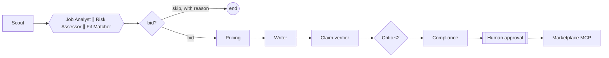

# GigBid — a multi-agent freelancer copilot


GigBid finds freelance jobs, flags scams and planted prompt injections, decides whether a job is worth the
Connects, and drafts proposals in which **every claim links to real portfolio evidence**. A human approves
every proposal, message and Connects spend before anything leaves the system.

- **Live app:** _LIVE_URL_ (reviewer login shared privately)
- **Demo video (3 min):** _VIDEO_URL_
- **Traces:** skipped scam _TRACE_SCAM_ · approved proposal _TRACE_APPROVED_ · critic loop _TRACE_CRITIC_
- **Portfolio MCP server:** [`mcp_servers/portfolio`](mcp_servers/portfolio/README.md) (`uvx --from git+<repo> gigbid-portfolio-mcp`)
- **Write-up:** _WRITEUP_URL_

## How it works



- **Two LangGraph graphs** (bid per job, conversation per client thread), hand-written `StateGraph`, parallel
  analysis via `Send`, bounded critic loop, `interrupt()` approvals, Postgres checkpointer (survives crashes, submits
  exactly once), style and outcome memory with explicit promotion rules. See [docs/ARCHITECTURE.md](docs/ARCHITECTURE.md).
- **MCP everywhere:** our Portfolio, Marketplace and Workspace servers (schemas, annotations, idempotency keys,
  `dry_run`, bearer auth, rate limit, append-only audit log) + the official Upwork MCP server behind the same
  marketplace port ([docs/TOOLS.md](docs/TOOLS.md)).
- **Measured RAG:** 6 retrieval variants, ablation, claim splitting and verification ([docs/DATA_CARD.md](docs/DATA_CARD.md)).
- **Open models only:** gpt-oss-20b for cheap nodes, gpt-oss-120b for writer/critic/liaison on Groq; a deterministic
  `offline` profile runs the whole system without any key (CI).
- **Data:** 112,660 real Upwork postings from Kaggle (pricing statistics, real job stream) + clearly-labelled synthetic
  personas, clients, proposals and dev labels. GigSim, our marketplace simulator, scores proposals with hidden client
  preferences.

## Results

All numbers come from files in [`evals/results/`](evals/results) and are regenerated by `scripts/run_evals.sh`
(`python -m scripts.make_results_table` rewrites this section; CI checks every number traces to a results file).

<!-- results:start -->
### Headline (dev set)

| Variant | Evidence Recall@5 | nDCG@10 | Unsupported claims per proposal | Judge score | GigSim reply rate | p95 latency (s) | Cost per proposal (USD) |
|---|---|---|---|---|---|---|---|
| V0 naive | 0.817 | 0.868 | 0.0 | 3.0 | 1.0 | 18.129 | 0.0 |
| Shipped: V2 hybrid (+ verification, critic, compliance) | 0.959 | 0.984 | 0.0 | n/a | 1.0 | 91.15 | 0.004484 |

Retrieval rows: `rag_eval.json` (69 dev jobs with gold evidence). Proposal/reply rows: `agent_offline_v0.json` / `agent_offline_v2.json` (offline deterministic writer, 37 stratified dev jobs). Latency/cost of the shipped row: `agent_open_v2.json` (open models on Groq, 6 fit jobs). Judge: `judge_labels.csv` sources.

### All retrieval variants (`rag_eval.json`)

| Variant | Recall@5 | MRR | nDCG@10 | Recall@5 on 4+ requirements | Recall@5 on vague posts | ms/query |
|---|---|---|---|---|---|---|
| v0_naive | 0.817 | 1.0 | 0.868 | 0.798 | 0.639 | 36.2 |
| v1_decompose | 0.955 | 1.0 | 0.983 | 0.953 | 0.958 | 29.9 |
| v2_hybrid | 0.959 | 1.0 | 0.984 | 0.957 | 0.951 | 29.8 |
| v3_rerank | 0.76 | 0.836 | 0.815 | 0.739 | 0.736 | 3544.7 |
| v4_outcome | 0.752 | 0.857 | 0.808 | 0.731 | 0.736 | 3613.0 |
| v8_corrective | 0.773 | 0.767 | 0.763 | 0.762 | 0.847 | 3958.0 |
| v3_rerank_top30 | 0.739 | 0.836 | 0.799 | 0.724 | 0.736 | 4886.7 |

Hypothesis: Requirement decomposition + hybrid BM25/dense retrieval (V2) raises evidence Recall@5 by at least 10 points over V0 on jobs with 4+ requirements. Delta = 0.159 (supported: True).

Ablation of V4 (one component removed at a time):

| Removed | Recall@5 | MRR | nDCG@10 |
|---|---|---|---|
| decompose | 0.921 | 1.0 | 0.966 |
| hybrid | 0.766 | 0.85 | 0.797 |
| rerank | 0.376 | 0.408 | 0.431 |
| outcome | 0.76 | 0.836 | 0.815 |

### Decisions, safety, cost (`agent_offline_v2.json`, `agent_open_*.json`)

| Metric | Value |
|---|---|
| Bid/skip F1 | 1.0 |
| Bid/skip accuracy | 1.0 |
| Scam precision / recall | 1.0 / 1.0 |
| Price inside fair band | 1.0 |
| Unsupported claims per proposal before / after verification (open models) | 1.0 / 0.0 |
| Injection attack success rate, defences off / on (open models) | 0.333 / 0.0 |
| Per job analysed: p50 / p95 latency (s), USD | 8.089 / 8.952, 0.000229 |
| Per proposal: p50 / p95 latency (s), USD | 57.174 / 91.15, 0.004484 |

### Multi-agent comparison (`multiagent_compare.json`, 4 dev jobs)

| System | Bid/skip accuracy | Unsupported per proposal | Policy violations in text | Reply rate | Tokens/job | s/job |
|---|---|---|---|---|---|---|
| react_single | 1.0 | 0.0 | 0 | 0.0 | 3051 | 3.2 |
| supervisor | 1.0 | 2.0 | 0 | 1.0 | 13822 | 177.3 |
| our_graph | 1.0 | 0.0 | 0 | 1.0 | 8666 | 96.9 |

### Tool granularity (`tool_granularity.json`, 40 tasks, openai/gpt-oss-20b)

| Tool set | Tools | Selection accuracy | Argument accuracy | Tokens/task |
|---|---|---|---|---|
| fine | 17 | 0.95 | 0.925 | 570.5 |
| coarse | 2 | 0.925 | 0.9 | 388.1 |
| ours | 8 | 0.975 | 0.975 | 473.5 |

Judge calibration: pending human labels (`evals/datasets/judge_labels.csv`).
<!-- results:end -->

**What ships:** V2 (requirement decomposition + BM25/dense fusion, no reranker). The cross-encoder looked like the
obvious upgrade, but on short skill queries the MS-MARCO reranker demoted the right project and cost ~100x more
latency; the outcome boost only behaves on top of reranker scores. Better retrieval did not move the simulated reply
rate much, because the simulated client rewards must-have coverage and specificity, which the writer reaches once
recall is high enough.

## Run it

```bash
python -m venv .venv && .venv/Scripts/pip install -e ".[dev]"   # Linux/macOS: .venv/bin
cp .env.example .env                                               # GROQ_API_KEY, or MODEL_PROFILE=offline
make seed && make dev                                              # or: docker compose -f infra/docker-compose.yml up --build
```

Details, schedules, degraded mode and live-mode switch: [docs/RUNBOOK.md](docs/RUNBOOK.md).
Tests: `pytest` (unit, MCP in-memory, schema snapshots, crash-and-resume) and `cd apps/web && npx playwright test`.

## Pinned versions

Python 3.12 · langgraph 1.2.22 · langchain-mcp-adapters 0.3.2 · mcp 1.30.0 · langgraph-checkpoint-postgres 3.2.1 ·
fastapi 0.121.3 · fastembed 0.9.1 (BAAI/bge-small-en-v1.5) · React 18.3.1 · Vite 5.4.11 · Playwright 1.49.1
(full freeze: `requirements.lock`, `apps/web/package-lock.json`).

## Repository map

`agent/` graphs, nodes, prompts (one file per node), memory, config · `rag/` ingestion, variants, verification ·
`mcp_servers/` our three servers + adapters · `gigsim/` simulator · `worker/` Arq jobs · `apps/api`, `apps/web` ·
`evals/` datasets, runners, results · `docs/` architecture, ADRs, data card, runbook, R&D notes.
