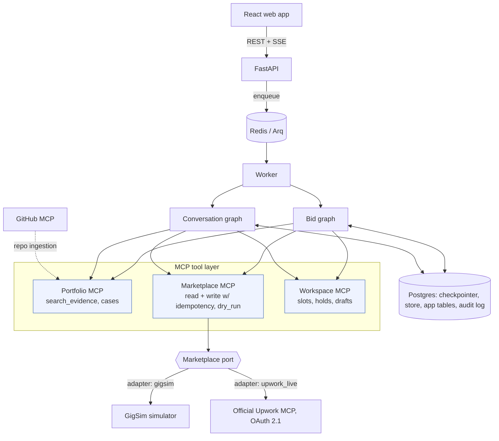
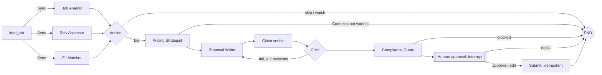

# Architecture

## Bid graph (one thread per job, `agent/graphs/bid_graph.py`)

The conversation graph is `load_thread -> client_liaison (intent, reply, free slots) -> compliance -> approval
interrupt -> send_reply (+ tentative hold)`.

## Why each agent exists

| Agent | Why it is separate | Model | Tools |
|---|---|---|---|
| Scout | runs on a schedule, outside any job thread; dedupes by id and content hash | none | `search_jobs`, `get_job`, `list_events` |
| Job Analyst | turns untrusted prose into a typed `JobSpec`; no tools, so an injected instruction has nothing to call | small | none |
| Risk Assessor | rules (regex signals + client history) give a measurable, injection-proof score; the model only adds explanation | small | `get_client_history` |
| Fit Matcher | requirement-to-evidence matrix; deterministic coverage scoring so decisions are reproducible | none | `search_evidence`, `list_skills` |
| Decide | thresholds from config + outcome memory; skip reasons shown to the user | none | none |
| Pricing Strategist | market statistics (real Kaggle data), client spend, floor rate, Connects worth | none | `get_market_stats`, `get_connects_balance` |
| Proposal Writer | strongest model; sees only retrieved evidence and learned style rules | strong | `search_evidence`, `get_case_study` |
| Claim verifier | splits claims, checks each against cited evidence, repairs before the Critic | small + rules | none (evidence in state) |
| Critic | bounded loop (max 2) on grounding, personalisation, length | strong | none |
| Compliance Guard | deterministic policy enforcement from `agent/policy.yaml` (contacts, guarantees, free work, fabrication, injected tokens) | none | none |
| Client Liaison | intent, reply, interview slots | strong | messages, workspace |

Several roles are deterministic on purpose: anything that must be auditable or injection-proof (risk score, fit
coverage, decision, compliance) is code driven by configuration; models write and explain.

## State, trace and memory (kept apart)

- **State** (`agent/state.py`): typed fields for the job, analyses, evidence, decision, price, drafts, critiques,
  approvals; reducers on lists that parallel branches append to (`usage`, `trace`, `errors`, `degraded`).
- **Execution trace**: every node's tool calls/results in `trace`, the `runs`/`run_steps` tables, the MCP `audit_log`
  (same trace id), and LangSmith when configured.
- **Long-term memory** (`agent/memory/`, LangGraph `PostgresStore`): style rules promoted only after a pattern repeats
  in 2 edits; outcome counts per category only from marketplace events. Viewable/deletable in Settings.

## Marketplace port

`agent/marketplace_port.py` defines one interface; `mcp_servers/marketplace/adapters/{gigsim,upwork_live}.py` implement
it; `marketplace.adapter` in config selects one. Nothing above the MCP server knows which marketplace is used.

## Human in the loop and durability

`interrupt()` before any submission/message; payload = draft, evidence per claim, risk report, price rationale and the
`dry_run` preview. Postgres checkpointer makes the wait durable; idempotency keys make the submit exactly-once;
`autonomy` can auto-skip low-fit jobs but there is no code path that sends without an approval.
